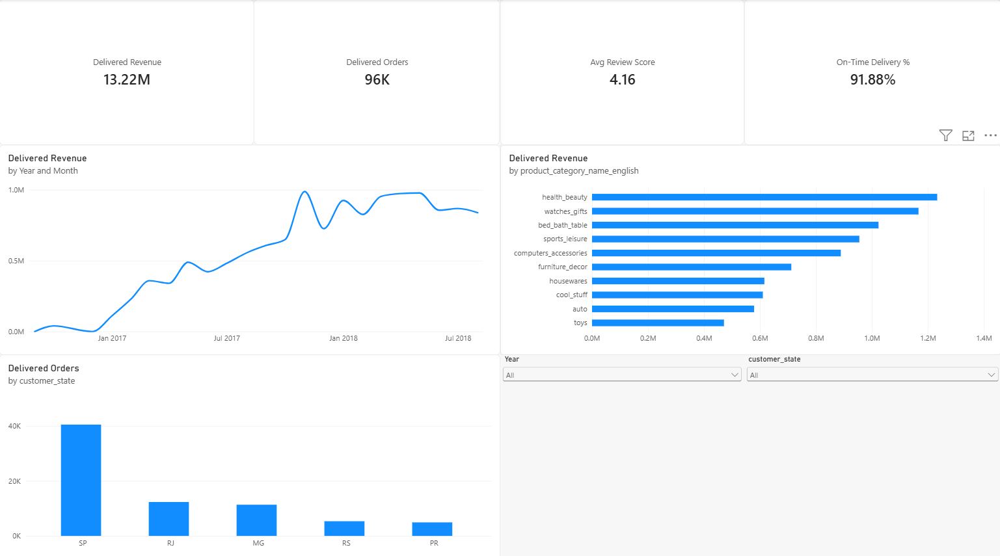

# Brazilian E-Commerce Logistics & Revenue Analytics (Olist)

End-to-end data analytics case study examining **99,441 e-commerce orders** across Brazil (2016–2018) to identify revenue drivers, regional concentration, customer retention bottlenecks, and the impact of delivery delays on customer satisfaction.

## Tools & Workflow
* **Excel:** Initial schema auditing, null-value inspection across 9 relational CSV tables, and business rule documentation.
* **SQL (SQLite):** Multi-table `JOIN`s, `CASE WHEN` conditional logic, `COALESCE` null handling, and CTEs (`WITH`) to quantify order status breakdowns, monthly trends, category revenue, and customer retention.
* **Power BI:** Star-schema data modeling, DAX measures (`CALCULATE`, `DIVIDE`, `DISTINCTCOUNT`), and an interactive executive dashboard with dynamic Year and State slicers.

## Dashboard Preview

## Key Analytical Findings
1. **Delivery Delays Severely Damage Ratings:** On-time deliveries (**91.88%** of delivered orders) average a **4.29★** review score, whereas late deliveries drop to **2.57★**—a **1.72-star penalty**.
2. **Low Customer Retention:** Out of **93,358** unique delivered customers, only **2,801 (3.0%)** placed a repeat order, indicating heavy reliance on one-time acquisition.
3. **High Geographic & Category Concentration:** **São Paulo (SP)** alone accounts for **40,501 delivered orders** (~42% of volume). Top revenue categories are **Health & Beauty ($1.23M)**, **Watches & Gifts ($1.17M)**, and **Bed, Bath & Table ($1.02M)**.
4. **Revenue Leakage:** **461 canceled orders** represent **$95.2K** in unfulfilled item revenue.

## Business Recommendations
* **Prioritize Last-Mile SLAs Outside SP:** Tightening carrier dispatch windows on long-haul routes (RJ, MG, RS) can recover the 1.72★ rating gap on late shipments.
* **Launch Post-Purchase Retention Campaigns:** Target first-time buyers in top-performing categories (`health_beauty`, `bed_bath_table`) with 30-day replenishment incentives to lift the 3.0% repeat rate.
